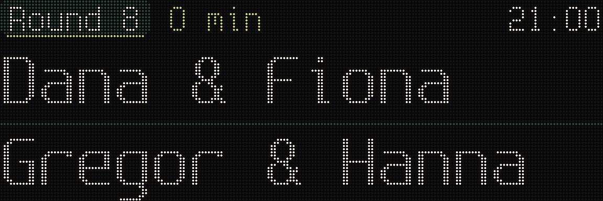
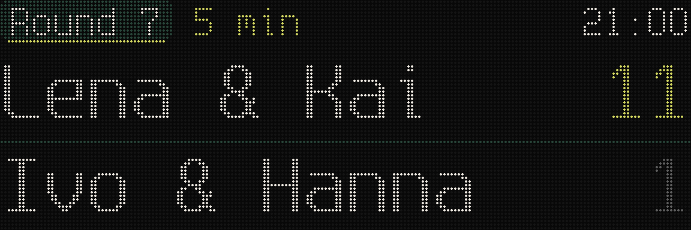
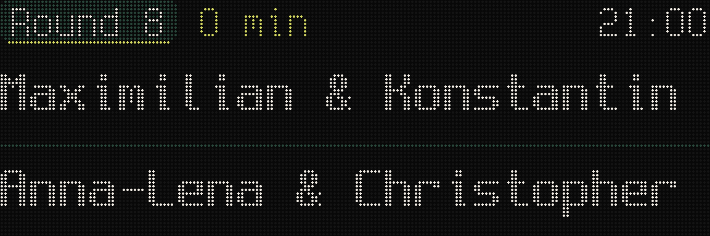
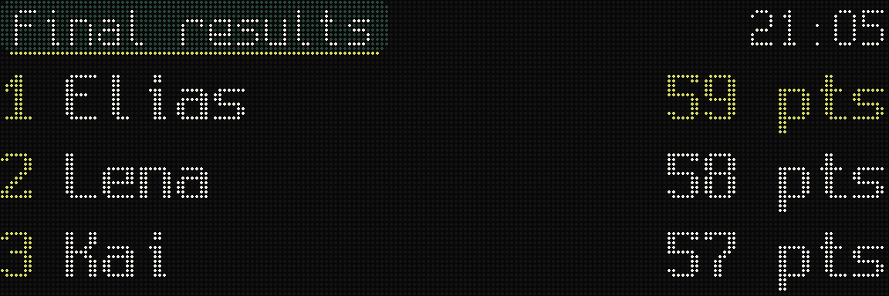
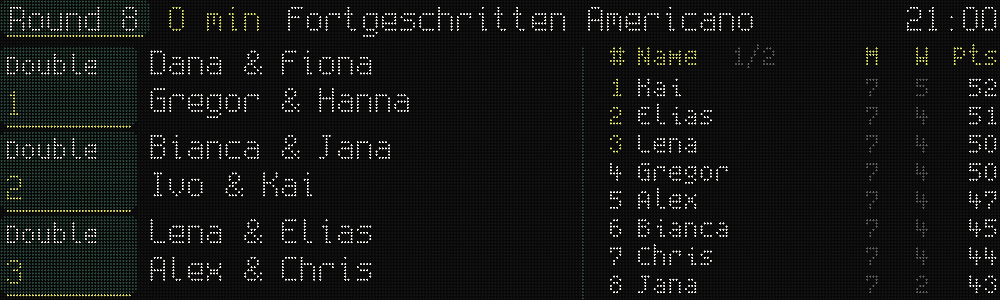
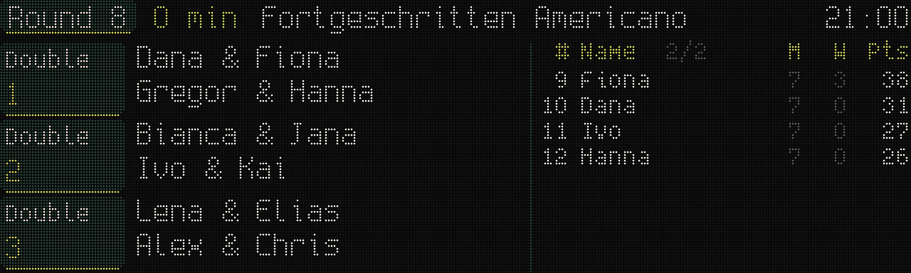
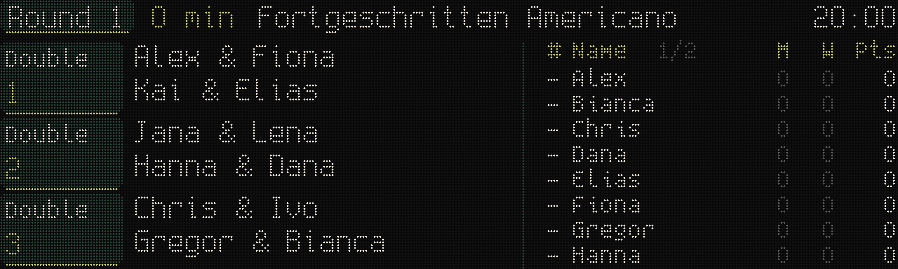
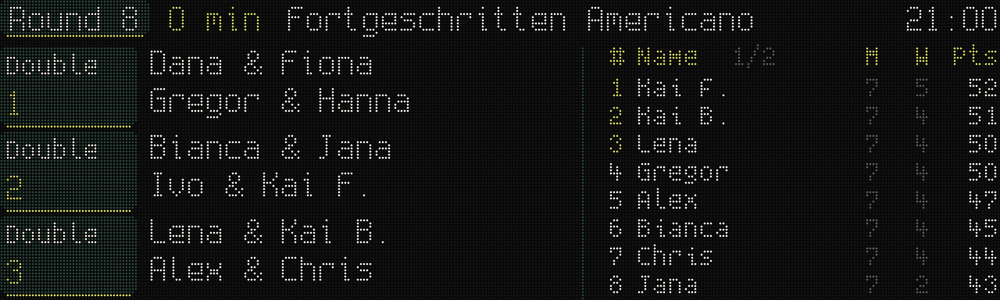
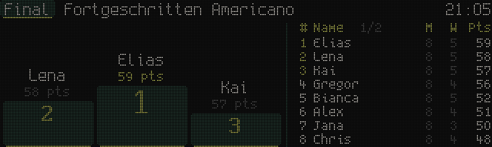
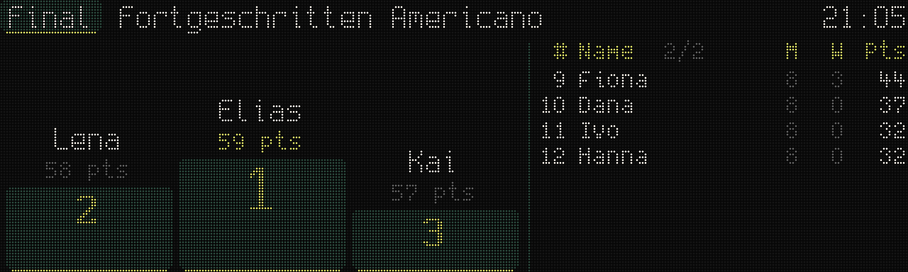

# Americano views: mockups

Pixel mockups for showing a running Playtomic Americano on M1 and XL1
(`led-0jh`, before `led-u9b` builds the views; epic `hub-uw8l` in
sevencourts.hub). Data: Padel Club Esslingen's "Fortgeschritten Americano" of
2026-10-15, rebuilt in 5-minute steps from Manager snapshots, players replaced
by fake names (`mockup-data.json`). How the data is obtained:
`tennismath.tableau` `docs/playtomic/tournaments.md`.

Rendered by `tools/americano_mockups.py` with the firmware's BDF fonts, its
`DrawText`, `fill_rect` and the Padel Club Esslingen style from
`club_styles.py`. `*.png` is native resolution, `*.leds.png` the same as LED
dots.

## Decisions (Ilya, 2026-10-15)

| Topic | Decision |
|---|---|
| Roles | An M1 stands at a court and shows that court only. The XL1 is central and shows the whole tournament. |
| M1 content | Round number, minutes since the round appeared, clock, the two teams. |
| Between rounds | Once the court's result is entered and until the next round exists, M1 shows the score next to the teams. |
| Elapsed time | From when the server first sees the round. Playtomic stores no round start time; when the organiser creates rounds late or in bulk, this is off. |
| Names | First names; when two players share one, both get their surname's initial ("Kai F.", "Kai B."), in teams and leaderboard alike. |
| XL1 layout | Side by side: the current round, one row per court, left; the leaderboard right. |
| Leaderboard | Position, name, matches (M), wins (W), points (Pts), sorted by points then wins, as Manager does. Paged through all players, 8 per page. Once finished, Playtomic's `final_standings` give the order. |
| Style | Padel Club Esslingen: cream text, green boxes, lime accents. |
| Language | English labels (Round, Final results, M, W, Pts). |
| Courts on XL1 | Three, as Padel Club Esslingen plays its Americanos. |
| Court name on M1 | None; the panel stands at the court. |
| End | A final screen as soon as the organiser presses Finish in Manager (`operative_status` `FINISHED`); until then the last round stays up. |

## M1 (192x64), at a court

Round in progress:

Result entered, next round not created yet; the winning score in lime:

Long names: both teams drop from Spleen 12x24 to 8x16 together, so the two
lines always match:

Final, once the organiser presses Finish: the top three.

Layout: a 12 px header (round in the booking views' court box, elapsed time in
lime, clock in cream at the right), then two 24 px team rows split by a green
line. With a score, the names give up the width of two 12x24 digits.

## XL1 (320x96), central

Leaderboard page 1 and page 2:

Round 1, before any result: no ranking yet, players alphabetically, positions
shown as dashes:

Two players with the same first name (a fake clash):

Final, once the organiser presses Finish: a podium in Manager's 2-1-3 order
beside the final standings, paged:

Layout: a 12 px header across the panel (round, elapsed time, tournament
name, clock); left of x=186 one 27 px row per court (court box, the two teams in
Spleen 6x12, the score at the right once entered); right of it the
leaderboard in Spleen 5x8 with the top three in lime.

## Ties

Points then wins reproduced Playtomic's final standings of the Women's
Americano exactly. In the Fortgeschritten Americano two players finished level
on everything we can see (32 points, 0 wins, 64 points against, partnered and
opposed each other) and Playtomic ranked them 11 and 12 in an order we cannot
derive. So: our order while the tournament runs, `final_standings` once it is
finished. Fully tied players keep consecutive positions, as in Manager.

## Open questions

- **Page interval.** 8 s per leaderboard page is a guess.
- **Compensation points** for players sitting out a round (player counts not a
  multiple of four) are not in this data; the columns stay the same.
- **Never finished.** A tournament whose organiser never presses Finish keeps
  showing its last round. When the panel goes back to bookings or idle
  afterwards (booking end time plus some grace?) is for `led-u9b`/`srv-4i7`.
